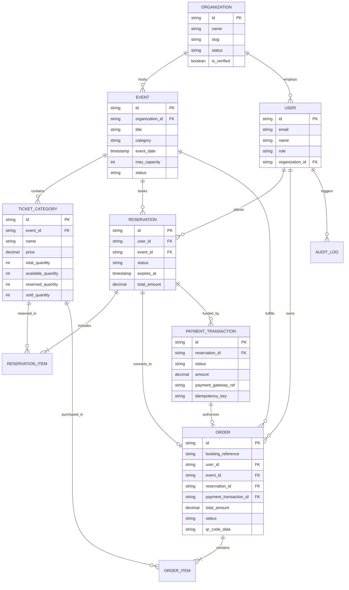

# TicketNest — Smart Event Booking and Management Platform

A high-performance, multi-tenant full-stack event ticketing platform with transactional ticket inventory management, strict 10-minute reservation holds, concurrency protection against overselling, simulated asynchronous payments with webhook callbacks, and comprehensive event analytics.

---

## 🏛️ System Architecture

```
[ Client: React + Vite + Tailwind ]
            │
            ▼ (REST API / Bearer Token & User Context)
[ Express.js Full-Stack Engine (server.ts) ]
    ├── Auth & Multi-Tenant Isolation
    ├── Transactional Reservation Engine (Row-Level Locking)
    ├── Simulated Payment Gateway & Webhook Handler
    └── Analytics Aggregator
            │
    ┌───────┴──────────────────────┬───────────────────────┐
    ▼                              ▼                       ▼
[ PostgreSQL / Prisma ORM ]   [ Redis Caching ]    [ BullMQ / Queue Worker ]
• Relational Source of Truth  • Public event lists • 10-min reservation hold timer
• Strict check constraints    • Category & venue   • Background expiration sweeper
• Mutex & Row Locks           • Cache-aside        • Idempotent inventory release
```

---

## 📊 Database Entity Relationship Diagram (ERD)



---

## 🛡️ Concurrency & Reliability Guarantees

1. **Zero Overselling**:
   Ticket category rows are locked during reservation creation (`SELECT ... FOR UPDATE` simulation via sorted mutex registry). Available quantity is atomically decremented and held stock is incremented.
2. **10-Minute Reservation Hold**:
   Reservations automatically expire after 10 minutes (600 seconds). A countdown timer guides the attendee. If unpaid, the BullMQ worker safely returns held inventory back to the available pool.
3. **Double-Release Prevention**:
   Release operations are strictly idempotent (`WHERE status = 'PENDING'`). Already confirmed or expired reservations cannot be released twice.
4. **Idempotent Webhooks & Payments**:
   Payment callbacks carry gateway references and idempotency keys, guaranteeing that repeated network callbacks will never duplicate orders or double-decrement stock.
5. **Multi-Tenant Isolation**:
   Organizers only query and mutate records belonging to their `organizationId`. Cross-tenant mutations return `403 Forbidden`.

---

## 🚀 Quick Start & Docker Deployment

### Local Development
```bash
# 1. Install dependencies
npm install

# 2. Run backend and frontend concurrently
npm run dev

# App runs at http://localhost:3000
```

### Docker Compose
```bash
docker compose up --build -d
```
This spins up:
- PostgreSQL 16 on port 5432
- Redis 7 on port 6379
- TicketNest App on port 3000

---

## 🧪 Automated Testing

Execute the automated test suite covering concurrency, expiration, payment failure, webhook idempotency, and tenant isolation:

```bash
npx tsx tests/concurrency.test.ts
```
